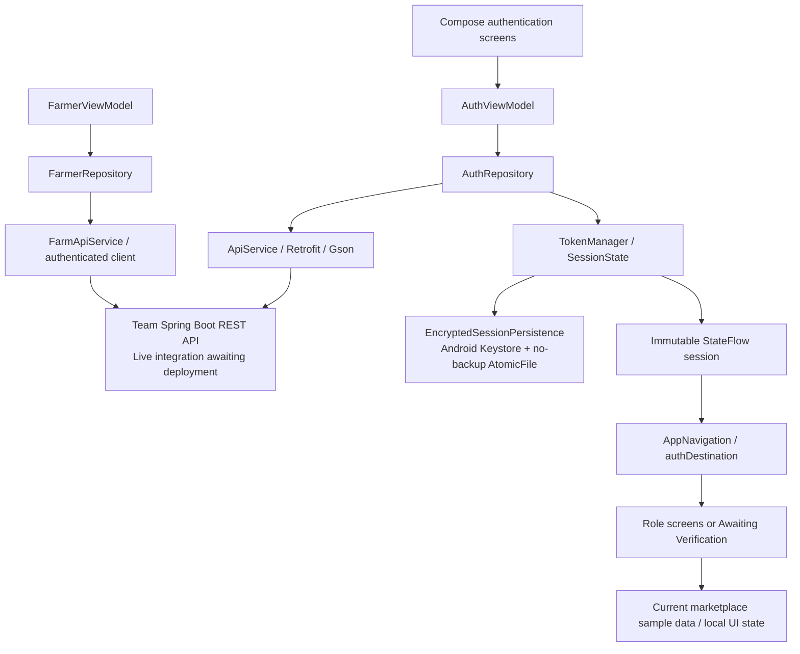

# Kilivana Android Application — Development Progress Report

**Review date:** 1 October 2026  
**Repository:** FarmApp / Kilivana Android  
**Branch reviewed:** `feature/auth-farmer-ui`  
**Scope:** Read-only review of Android source, tests, configuration, documentation, Git status/diff/history, and saved test reports. No builds or tests were run during this review. Only this report and the companion briefing were created after approval.

This report describes the current working tree, including uncommitted work. It records implementation evidence, not a claim that the entire application is complete. Personal assignment and individual authorship cannot be established solely from these files; the speaking script presents the development focus supplied by the developer.

**Evidence labels used throughout:**

| Label | Meaning |
|---|---|
| Implemented | A concrete Android code path exists and was traced. |
| Tested locally | Source tests and saved zero-failure reports support behavior under controlled dependencies. |
| Awaiting integration testing | Final deployed backend behavior has not been demonstrated by the reviewed evidence. |
| Planned / partially implemented | UI or supporting layers exist, but the complete behavior or integration remains. |

## 1. Executive Summary

Kilivana is an agricultural marketplace/platform application with Android areas for Farmers, Buyers, Suppliers, and Inspectors. Android development has focused on account access, secure session handling, role-based routing, and an improved user interface, particularly for Farmers.

The authentication/session/navigation foundation is implemented. Normal builds use a real Retrofit authentication service. The app validates authentication responses, persists sessions with Android Keystore encryption, restores eligible sessions on startup, refreshes credentials after protected requests receive HTTP 401, and supports logout. Signup and Inspector verification gating are implemented in the current working tree but remain uncommitted.

The Farmer interface includes an overview, quick access, crop/order/supply sections, status cards, detail dialogs, and local crop creation. These visual and interactive features currently use sample lists and in-memory state. Buyer, Supplier, and Inspector interfaces also contain local demonstrations. The repository does not prove functioning production marketplace, payment, delivery, inspection-evidence, or notification services.

Saved reports dated 29 September 2026 record **44 JVM tests and 9 connected instrumentation tests with zero failures/errors**. These demonstrate controlled local testing, including real Android Keystore behavior and Compose authentication flows with test dependencies. They do **not** constitute live Railway/backend integration testing.

According to the supplied team context, the main external dependency is completion and Railway deployment of the collaboratively maintained Spring Boot backend. This is an integration dependency, not an Android implementation failure. The next milestone is validating the account and verification flows against the team's final deployed environment.

**Primary implementation references:** [AuthViewModel](../app/src/main/java/com/example/farmapp/viewmodel/AuthViewModel.kt), [AuthRepository](../app/src/main/java/com/example/farmapp/repository/AuthRepository.kt), [AppNavigation](../app/src/main/java/com/example/farmapp/ui/navigation/AppNavigation.kt), and [FarmerScreen](../app/src/main/java/com/example/farmapp/ui/screens/FarmerScreen.kt).

## 2. Project Objectives

The Android project represents an agricultural community in which growers list produce, Buyers browse and order it, Suppliers manage agricultural inputs, and Inspectors review agricultural compliance. The account and routing support is concrete; most domain operations shown by the interfaces remain local prototypes.

| Role | Implemented Android representation | Integration boundary |
|---|---|---|
| Farmer | Public signup fields, role destination, overview, crop listings/details/creation dialog, incoming orders and supply sections. | Active screen uses local lists, not backend data. |
| Buyer | Public signup, role destination, produce browsing/search/category/price sorting, local checkout/order views. | Orders are constructed locally; real checkout/payment is unverified. |
| Supplier | Public signup with business name, role destination, searchable inventory/requisitions, local add/edit/delete and payment-status interactions. | Inventory and requisitions are local state. |
| Inspector | Public signup with employee code, verification-gated destination, sample audit records/checklist/notes/evidence/decision presentation. | Administrator verification belongs to backend; audit tools are local demonstrations. |

`SignupRole` in [AuthComponents.kt](../app/src/main/java/com/example/farmapp/ui/screens/auth/AuthComponents.kt) and `AuthValidation.supportedRoles` in [AuthValidation.kt](../app/src/main/java/com/example/farmapp/network/AuthValidation.kt) contain those four public roles. Admin, Driver, and unknown roles do not receive a supported dashboard. Driver information in sample orders is not a Driver application role.

Role interfaces: [BuyerScreen.kt](../app/src/main/java/com/example/farmapp/ui/screens/BuyerScreen.kt), [SupplierScreen.kt](../app/src/main/java/com/example/farmapp/ui/screens/SupplierScreen.kt), [InspectorScreen.kt](../app/src/main/java/com/example/farmapp/ui/screens/InspectorScreen.kt).

## 3. Android Architecture

The authentication path follows an MVVM-style separation: Compose presentation delegates actions to a ViewModel; a repository performs validation and service calls; Retrofit/Gson maps REST requests and responses; a single session owner publishes immutable state. The existing Farmer data layer follows a similar pattern, but its active UI has not been connected to it. It would be inaccurate to describe every screen as fully repository-backed MVVM.



The diagram stops at the backend: database technology and database behavior are not established by the Android repository. The Farmer data chain is present but is not connected to the active `FarmerScreen` displayed-data flow.

Technical foundations:

- **Entry point:** [MainActivity.kt](../app/src/main/java/com/example/farmapp/MainActivity.kt), `onCreate`, enables edge-to-edge content and renders `AppNavigation` inside `FarmAppTheme`.
- **Presentation:** Kotlin and Jetpack Compose, Material 3, reusable components, light/dark color schemes, typography, and spacing tokens.
- **State:** `AuthViewModel.uiState` and the session StateFlow are observed with `collectAsStateWithLifecycle`. `viewModelScope` drives asynchronous work; repository storage/network operations use `Dispatchers.IO`.
- **Navigation:** [AppNavigation.kt](../app/src/main/java/com/example/farmapp/ui/navigation/AppNavigation.kt) conditionally renders authentication, role, unsupported-account, or waiting screens. [LoginScreen.kt](../app/src/main/java/com/example/farmapp/ui/screens/LoginScreen.kt) manages local `AuthStep` transitions and back handling. No Navigation Compose graph is used.
- **Networking:** [ApiClient.kt](../app/src/main/java/com/example/farmapp/data/remote/ApiClient.kt) builds separate auth and protected-data clients. Retrofit uses relative paths beneath `BuildConfig.API_BASE_URL`.
- **Models:** [AuthModels.kt](../app/src/main/java/com/example/farmapp/data/model/AuthModels.kt) defines wire DTOs. Farmer, Product, Order, SupplyItem, and InspectionRecord model the displayed domain data; several include sample collections.
- **Session ownership:** [TokenManager.kt](../app/src/main/java/com/example/farmapp/network/TokenManager.kt) delegates to `SessionState`, which owns the immutable `SessionSnapshot` and synchronizes mutations. `EncryptedSessionPersistence` is its disk adapter, not a second session owner.
- **Configuration:** [app/build.gradle.kts](../app/build.gradle.kts) enables Compose and BuildConfig, minimum SDK 26, compile/target SDK 36, and JVM target 11. [libs.versions.toml](../gradle/libs.versions.toml) declares Kotlin 2.0.21 and AGP 8.11.2. Retrofit 2.11.0 and coroutines 1.8.1 are declared in the app build file; the Gradle wrapper uses 8.13.

## 4. Work Completed

### Authentication

**Implemented; locally tested; live backend validation outstanding.**

`SignInScreen` calls `AuthViewModel.login` through `LoginScreen`. The ViewModel refuses actions while initializing or loading, clears old errors, and invokes `AuthRepository.login`. The repository trims the email, preserves the entered password, sends `LoginRequest`, maps HTTP failures to safe messages, and validates the response before establishing a session.

`AuthValidation.validate` checks required fields, canonical UUID-shaped `userId`, and parseable ISO-8601 refresh expiry. `canRefresh` rejects already-expired refresh validity. It does not validate JWT signatures or infer identity from JWT claims. `AuthResponse` is the authoritative Android input for identity, role, token pair, and optional verification status.

`SessionState.establish` writes the complete response before publishing a new snapshot. `AppNavigation` observes it and leaves the authentication interface. `AuthViewModel` restores persisted state during initialization, with a loading indicator until initialization completes. Restoration accepts a structurally valid session with a future refresh expiry; it is not a fresh server check of account or verification state.

Logout calls `beginLogout`, attempts `auth/logout` using the stored refresh token, then clears locally in a `NonCancellable` cleanup block. Network failure or cancellation cannot intentionally retain an authenticated memory session. Disk/key deletion errors remain possible and are handled separately; remote revocation cannot be guaranteed if the server could not be reached.

Login errors include invalid credentials, forbidden sign-in, rate limiting, and general unavailability. The ViewModel uses a generic connection message for unexpected errors and propagates coroutine cancellation.

References: [SignInScreen.kt](../app/src/main/java/com/example/farmapp/ui/screens/auth/SignInScreen.kt), `AuthViewModel.login/restore/logout`, `AuthRepository.login/logout`, `SessionState.initialize/establish/clear`, and `AuthValidation.validate/canRefresh`.

**Demo versus normal builds:** `AuthViewModel.factory` selects the mock service only when both debug mode and explicit `USE_MOCK_AUTH` are true. Debug opt-in uses the Gradle property `kilivana.mockAuth=true` and adds `.demo` to the application ID. Release always sets mock authentication false. Demo sessions are memory-only; protected API calls reject demo sessions. There is no automatic fallback after a real login fails. Demo credentials and token values are intentionally omitted from this report.

### Signup

**Implemented in the current working tree; locally tested; uncommitted; awaiting deployed integration.**

[SignUpScreen.kt](../app/src/main/java/com/example/farmapp/ui/screens/auth/SignUpScreen.kt) provides a two-step details/password form. It calls `AuthViewModel.signup`, which delegates to `AuthRepository.signup` and `ApiService.signup`. Successful signup expects a full usable `AuthResponse`, saves that session, and triggers the same session-driven navigation as login. The Android client does not locally fabricate a successful signup response.

| Fields | Validation / preparation |
|---|---|
| Role | Must be Farmer, Buyer, Supplier, or Inspector using the supported uppercase values. |
| Full name | Required; trimmed. |
| Email | Required; basic regex format check; trimmed. |
| Phone number | Nonblank; trimmed. No detailed phone-format validation is implemented. |
| Password | 8–72 characters; preserved without trimming. No additional complexity policy is asserted. |
| Farmer farm name and location | Both required; trimmed. |
| Supplier business name | Required; trimmed. |
| Inspector employee code | Required, at most 100 characters before trimming. Android does not verify employment authenticity. |

[SignupValidation.kt](../app/src/main/java/com/example/farmapp/network/SignupValidation.kt), `prepare`, removes fields that do not belong to the selected role. Gson omits resulting null fields. Client validation happens on final submission; the first-step Next action does not independently validate all details.

The screen disables editing/submission while loading; the ViewModel independently prevents repeated signup calls while a request is active. These are local duplicate-submission protections, not a server idempotency guarantee.

Repository messages cover 400 invalid details, 409 possibly existing account/details, 429 rate limiting, 503 temporary unavailability, and generic other failures. Backend error bodies are not displayed. A duplicate-email response is a live test expectation to confirm, not a proven backend rule. Demo mode disables signup both in presentation and repository logic.

References: `SignupRequest` in [AuthModels.kt](../app/src/main/java/com/example/farmapp/data/model/AuthModels.kt), `ApiService.signup`, `AuthRepository.signup`, `AuthViewModel.signup`, and `SignupValidation.prepare`.

### Role-Based Navigation

**Implemented; locally tested.** [AuthDestination.kt](../app/src/main/java/com/example/farmapp/ui/navigation/AuthDestination.kt), `authDestination`, uses the server-returned role:

| Role | Destination |
|---|---|
| `FARMER` | `FarmerScreen` |
| `BUYER` | `BuyerScreen` |
| `SUPPLIER` | `SupplierScreen` |
| `INSPECTOR`, exact `VERIFIED` | `InspectorScreen` |
| `INSPECTOR`, any other verification state | `AwaitingVerificationScreen` |
| Any other role | Unsupported-account message; logout remains available. |

Signup selection does not override the role returned by the server. Admin and Driver sessions may be structurally valid responses, but do not gain a supported role destination. The common profile uses returned name/role and explicitly reports that sign-in does not provide a phone number, rather than inventing one.

### Inspector Verification

**Implemented in the current working tree; locally tested; uncommitted; backend workflow unverified.**

`AuthResponse.verificationStatus` is nullable and is preserved with the session during persistence/refresh. Routing accepts only the exact string `VERIFIED` for Inspector dashboard entry:

```kotlin
"INSPECTOR" -> if (auth.verificationStatus == "VERIFIED")
    AuthDestination.INSPECTOR else AuthDestination.AWAITING_VERIFICATION
```

`PENDING`, `UNVERIFIED`, missing/null, unknown, differently cased, or otherwise unexpected states use the waiting destination. This is a conservative gate: lack of recognized verification never grants inspection-tool access through application routing.

[AwaitingVerificationScreen.kt](../app/src/main/java/com/example/farmapp/ui/screens/auth/AwaitingVerificationScreen.kt) explains administrator verification and provides logout. Its generic pending/account-created wording is also used for missing/unknown states; it is not proof of a specific backend status. The global toolbar also offers logout.

There is no Android administrator verification API/interface, verification polling, or manual refresh control. The supported user path after administrator approval is logout and fresh login. The existing reactive refresh mechanism can also replace verification status if a protected request gets 401 and the backend returns updated status. The waiting screen itself does not issue a protected request to trigger that refresh.

Backend responsibilities remain: issue correct verification status on signup/login/refresh; perform administrator verification; enforce server authorization on protected inspection operations. Android gating is a presentation safeguard, not a substitute for backend access control. Persisted VERIFIED status is restored locally until a subsequent authoritative response updates it; immediate revocation detection is not implemented.

### Farmer UI

**Visually and interactively implemented; displayed data remains local.**

The authenticated Farmer destination is [FarmerScreen.kt](../app/src/main/java/com/example/farmapp/ui/screens/FarmerScreen.kt), not the separate `FarmerDashboardScreen` design. Its implementation includes:

- A greeting and search input; the displayed name is hardcoded, and the input currently does not filter the lists.
- `FarmerOverview` and `FarmerOverviewMetric`, showing counts derived from the local crop/order/supply collections.
- `FarmerShortcut` quick access for Crops, Orders, Supplies, and Audits.
- Incoming Orders, My Crops, and Supplies Ordered tabs; My Crops is selected initially.
- Pending-inspection summary and audit/detail presentation based on sample crop statuses.
- `FarmerCropCard`, `FarmerOrderCard`, and `FarmerSupplyCard`, reusable card presentation, status badges, and empty states.
- A Create Crop extended FAB opening a produce form. Publish constructs a local `Product` and inserts it into the in-memory list. It does not send a network request or persist a listing.
- Crop details, audit dialogs, and an order-tracking dialog using local objects.
- A scrolling layout, Material 3 theme styling, Farmer-specific rounded shapes, spacing, touch-target tokens, and light/dark support.

The active screen initializes `mockOrders`, selected `mockProducts`, and `mockSupplyItems` through Compose `remember` state. These are not user-owned server records, and local updates should not be described as durable marketplace actions. Numeric crop fields use fallback values when parsing fails; production form validation remains work to assess when integrating publishing.

[FarmerDashboardScreen.kt](../app/src/main/java/com/example/farmapp/ui/screens/FarmerDashboardScreen.kt) contains additional dashboard/chart presentation such as `OrganicChartHeader`, `WeeklyYieldBarChart`, `FarmerStockCard`, and `SoftFloatingBottomBar`. It is only independently defined/previewed, not called by the authenticated navigation path. Its presence does not prove live yield analytics or an integrated dashboard.

[FarmerViewModel.kt](../app/src/main/java/com/example/farmapp/viewmodel/FarmerViewModel.kt) and [FarmerRepository.kt](../app/src/main/java/com/example/farmapp/repository/FarmerRepository.kt) implement fetching and creation/state handling, plus repository CRUD wrappers. The active Farmer UI does not consume their displayed data. The API interface also declares county search, which is not wired through the active screen.

### Authentication UI

**Implemented; selected behaviors locally tested.**

`AuthWelcomeScreen` presents the entry branding and sign-in/signup choices. `LoginScreen` controls entry, welcome, sign-in, signup, and recovery steps, clears errors during transitions, and handles back navigation. Sign-in passwords stay in local `remember` state rather than saved-instance state; signup form values are also local state.

[AuthComponents.kt](../app/src/main/java/com/example/farmapp/ui/screens/auth/AuthComponents.kt) supplies `AuthTheme`, `AuthPage`, `AuthHeading`, `AuthField`, `AuthPrimaryButton`, `AuthNotice`, and role/account dropdowns. Features include password show/hide, keyboard actions, loading indicators, disabled controls during submission, scrolling/keyboard insets, themed colors, and accessibility headings/live regions. Signup uses a public-role selector. The sign-in account selector exists only in explicit demo mode.

[PasswordRecoveryScreen.kt](../app/src/main/java/com/example/farmapp/ui/screens/auth/PasswordRecoveryScreen.kt) is clearly a preview with local steps. No recovery endpoint, delivered code, or real password reset is implemented.

Reusable styling/feedback: [KilivanaComponents.kt](../app/src/main/java/com/example/farmapp/ui/components/KilivanaComponents.kt), [KilivanaFeedback.kt](../app/src/main/java/com/example/farmapp/ui/components/KilivanaFeedback.kt), [Theme.kt](../app/src/main/java/com/example/farmapp/ui/theme/Theme.kt), [KilivanaTokens.kt](../app/src/main/java/com/example/farmapp/ui/theme/KilivanaTokens.kt), and [Type.kt](../app/src/main/java/com/example/farmapp/ui/theme/Type.kt).

### Networking

**Implemented; locally tested using controlled transports.**

`ApiClient` uses `BuildConfig.API_BASE_URL`, Gson conversion, 30-second connect/read/write timeouts, and a 60-second call timeout. HTTP logging and redirects are disabled on both clients. Normal platform TLS validation is retained; certificate pinning is not implemented by this code.

The auth client handles signup/login/refresh/logout without the token interceptor. The Farmer client attaches `AuthTokenInterceptor`. That interceptor limits session-header injection to matching scheme, host, port, and configured base path, and excludes auth paths. It rejects protected API use in demo mode or while logout is active.

On a replayable protected request's 401, `RefreshCoordinator.refresh` runs under a mutex. It checks session generation, logout state, demo status, refresh expiry, and whether another request already rotated the snapshot. The complete new response is persisted/published before one retry. A second 401 clears the matching session. One-shot/duplex or canceled requests are not automatically replayed.

Refresh 400/401/403, invalid responses, or expired refresh validity clear the relevant session. Transient failures preserve it and suppress repeat refresh attempts for five seconds. Snapshot checks prevent late refresh results or old requests from mutating a newer login. These mechanisms are verified locally, not against the team's deployed refresh/revocation policies.

References: [AuthTokenInterceptor.kt](../app/src/main/java/com/example/farmapp/network/AuthTokenInterceptor.kt), `intercept`, `RefreshCoordinator.refresh`; [ApiService.kt](../app/src/main/java/com/example/farmapp/network/ApiService.kt); [FarmApiService.kt](../app/src/main/java/com/example/farmapp/data/remote/FarmApiService.kt).

### Security

**Concrete session protections are implemented; broader security certification is not claimed.**

`EncryptedSessionPersistence` uses an Android Keystore AES-256 key and `AES/GCM/NoPadding`, with a fresh 12-byte IV and authenticated additional data. A versioned encrypted payload is stored through `AtomicFile` in `Context.noBackupFilesDir`. The complete auth response is encrypted; passwords are not part of that persisted response. Temporary plaintext byte arrays are cleared, although JVM strings and general process memory are not guaranteed to be wiped.

Corrupt ciphertext, missing/invalidated keys, and invalid stored responses require sign-in rather than plaintext fallback. `SessionState.initialize` also discards sessions with expired refresh validity. Logout deletes the storage file and key; memory is cleared even if a disk cleanup operation fails. Persistence failures do not publish a partially updated session/token pair.

DTO/session `toString` implementations redact their contents, and API clients avoid HTTP logging. Debug demo sessions are isolated and not persisted; release cannot enable mock authentication through the demo property. Unsupported roles do not gain one of the four supported dashboards.

[AndroidManifest.xml](../app/src/main/AndroidManifest.xml) permits Internet and Camera access and marks camera hardware optional. The app-level `allowBackup` flag remains true and backup XML files are largely templates; this report claims no-backup placement specifically for the encrypted session file, not disabled backups for the whole app. Camera permission alone does not prove working evidence capture. Hardware-backed/StrongBox key storage, biometric gating, rooted-device resistance, and server-side authorization are not established by this implementation.

## 5. Backend Integration

The backend is collaboratively maintained Spring Boot software according to the supplied project context. Its final Railway deployment and database behavior were not inspected in this Android-only audit.

The current Android build config supplies an HTTPS ngrok URL with `/api/v1/`. The hostname is omitted here to avoid reproducing environment-specific configuration. No final Railway URL is present in the reviewed build configuration. Changing the environment is future integration work and was not performed in this task.

### Authentication contracts represented by Android

All paths below are relative to the configured API base; `/api/v1/` must not be duplicated.

| Method/path | Request represented by Android | Expected Android result |
|---|---|---|
| `POST auth/signup` | Common signup fields plus applicable role fields described in Section 4. | `Response<AuthResponse>`; successful result must contain a usable session. |
| `POST auth/login` | `email`, `password` only. | `Response<AuthResponse>`. |
| `POST auth/refresh` | `refreshToken` only. | Full updated `AuthResponse`, including identity, token pair, expiry, and verification state when supplied. |
| `POST auth/logout` | `refreshToken` only. | `Response<Unit>`; local cleanup occurs even if server request fails. |

`AuthResponse` fields: `userId`, `email`, `fullName`, `role`, `accessToken`, `refreshToken`, `refreshTokenExpiresAt`, and nullable `verificationStatus`. UUID/expiry values remain strings; expiry parsing uses `OffsetDateTime`. Android requires the seven non-verification fields and future refresh validity before creating a session. Tokens are treated as opaque bearer credentials. A fixed access-token lifetime or JWT claims/signature validity cannot be established from this client.

### Farmer contracts represented by Android

| Method/path | Android signature / model |
|---|---|
| `GET farmers` | Returns `List<Farmer>`. |
| `GET farmers/{id}` | Numeric `Long` path ID; returns `Farmer`. |
| `POST farmers` | Sends `Farmer`; returns `Farmer`. |
| `PUT farmers/{id}` | Sends `Farmer`; returns `Farmer`. |
| `DELETE farmers/{id}` | Returns `Response<Unit>`. |
| `GET farmers/search?county=...` | County query; returns `List<Farmer>`. |

[Farmer.kt](../app/src/main/java/com/example/farmapp/data/model/Farmer.kt) contains `id`, `name`, `phone`, `county`, and `cropTypes`. Its numeric ID is distinct from the UUID-string authentication user ID; their relationship is not defined by this Android code. Interface declarations prove Android expectations, not matching deployed endpoints or successful CRUD.

No verified Android API contract for administrator verification, payments, deliveries, notifications, produce publishing, or inspection evidence is present in the reviewed service interfaces. Product/Order/Inspection DTO-like models do not establish those services.

**Awaiting final-environment verification:** request/response compatibility, role registration permissions, Inspector employee-code rules, verification status updates, refresh token rotation/rejection, remote logout revocation, server authorization, error-status mapping, and availability. The final end-to-end run must use the team's deployed backend URL and authorized accounts.

## 6. Testing Completed

Source coverage and saved execution evidence were inspected separately. The JVM XML files under `app/build/test-results/testDebugUnitTest/` record **44 tests, zero failures, zero errors, zero skips**, dated 29 September 2026. This total includes one template arithmetic test.

The connected XML report at `app/build/outputs/androidTest-results/connected/debug/TEST-SM-A155F - 16-_app-.xml` records **9 tests, zero failures, zero errors, zero skips**, dated 29 September 2026, on the recorded SM-A155F / Android 16 device. The 9 comprise 4 authentication-flow tests, 4 encrypted-persistence tests, and 1 application-context test. The network-package subset alone contains 8 tests.

These are saved historical artifacts. No tests were rerun during the documentation audit; the files do not bind themselves to an exact current source hash. They are not live Railway/backend integration evidence. Earlier execution/compilation claims in the old authentication document are historical statements and should not replace the concrete report counts.

| Area | Test Type | What Is Tested | Current Evidence |
|---|---|---|---|
| Authentication wire contract | JVM, `AuthContractTest` — 5 | Request field sets, relative endpoints, eight-field response round trip, missing-field rejection, unsupported roles, redacted representations. | Matching saved XML records zero failures. |
| Retrofit / bearer / retries | JVM, `AuthNetworkTest` — 6 | Exact request URLs/bodies with test transport; auth calls without bearer; 401 refresh and one retry; second 401 cleanup; origin/path isolation; no recursive refresh; demo-token blocking. | Matching saved XML records zero failures; controlled transport, no live server. |
| Repository | JVM, `AuthRepositoryTest` — 8 | Server identity, email/password handling, signup persistence/field preparation/error mapping, no production fallback, offline logout, cancellation behavior. | Matching saved XML records zero failures; stub services/storage. |
| Refresh coordination | JVM, `RefreshCoordinatorTest` — 7 | Concurrent calls share refresh; reuse rotated snapshot even if access string is unchanged; rejection cleanup; transient cooldown; late logout race; identity mismatch; cancellation. | Matching saved XML records zero failures. |
| Session engine | JVM, `SessionStateTest` — 7 | Restoration, atomic pair replacement, stale mutation protection, expiry/malformed data rejection, demo non-persistence, write-failure behavior. | Matching saved XML records zero failures; memory adapter, not actual Keystore. |
| Signup validation | JVM, `SignupValidationTest` — 4 | Applicable JSON fields per role, password boundaries/preservation, employee-code limit, required fields/public roles. | Matching saved XML records zero failures. |
| Routing | JVM, `AuthDestinationTest` — 2 | Login/signup/restore routing across roles and verification states; refreshed verification changes persisted routing. | Matching saved XML records zero failures; controlled auth responses. |
| Authentication presentation helpers | JVM, `AuthPresentationTest` — 4 | Demo account/role mapping, email edits, wrong-credential rejection, response-driven role. | Matching saved XML records zero failures; not full rendered UI coverage. |
| Compose authentication integration | Instrumentation, `AuthFlowIntegrationTest` — 4 | Signup loading guard; Inspector signup/waiting screen/dashboard absence and simulated session update; password visibility/server role/unsupported logout; invalid-login error. | Connected report records zero failures; production UI/ViewModel/repository with test service and in-memory persistence. |
| Actual encrypted storage | Instrumentation, `EncryptedSessionPersistenceTest` — 4 | Ciphertext restoration including verification state; non-exportable key check; deletion; tampering; lost-key rejection. | Connected report records zero failures; actual Android Keystore with isolated aliases/files. |
| Template checks | JVM 1; instrumentation 1 | Arithmetic and application package context. | Included in totals; limited feature value. |

Test sources are under [app/src/test/java/com/example/farmapp](../app/src/test/java/com/example/farmapp) and [app/src/androidTest/java/com/example/farmapp](../app/src/androidTest/java/com/example/farmapp). The Inspector UI test directly rotates a test session to VERIFIED; it does not contact an administrator API or prove backend approval. No dedicated Farmer repository/domain-operation suite or comprehensive marketplace UI suite was found.

## 7. Current Git / Development State

The reviewed branch is **`feature/auth-farmer-ui`**. Relevant history:

| Commit | Date | Recorded change |
|---|---|---|
| `1267691` | 28 September 2026 | Integrate real authentication and refine Kilivana UI. Contains the authentication/session/network foundation, UI changes, tests, and existing auth documentation. |
| `ccfc45a` | 23 September 2026 | Initial role gateway, order-handshake and verification models/UI foundation. Commit wording is not proof of completed backend services. |

There are uncommitted changes; the staged diff is empty. The current signup and Inspector-routing work extends the committed authentication foundation.

**Modified application files** (all under `app/src/main/java/com/example/farmapp/`):

- `data/model/AuthModels.kt` and `network/ApiService.kt`: signup DTO/service and verification response field.
- `repository/AuthRepository.kt` and `viewmodel/AuthViewModel.kt`: real signup orchestration.
- `ui/navigation/AppNavigation.kt`: shared destination selection and waiting screen.
- `ui/screens/LoginScreen.kt`, `ui/screens/auth/AuthComponents.kt`, and `ui/screens/auth/SignUpScreen.kt`: signup wiring, role selection, fields, errors/loading.

**New application files:** `network/SignupValidation.kt`, `ui/navigation/AuthDestination.kt`, and `ui/screens/auth/AwaitingVerificationScreen.kt`.

**Modified test files:** instrumentation `AuthFlowIntegrationTest.kt` and `EncryptedSessionPersistenceTest.kt`; JVM `AuthContractTest.kt`, `AuthNetworkTest.kt`, `AuthRepositoryTest.kt`, `AuthTestFixtures.kt`, and `AuthPresentationTest.kt`.

**New tests:** `SignupValidationTest.kt` and `ui/navigation/AuthDestinationTest.kt`.

**Other working-tree files:** modified `.idea/deploymentTargetSelector.xml` and `.idea/gradle.xml`, new `.idea/vcs.xml`, and an empty untracked `AGENTS.md`. The `.idea` files appear to be IDE metadata and should be reviewed separately rather than automatically included in a signup feature commit. `AGENTS.md` is not an application feature.

No files were staged, committed, reset, cleaned, checked out, or otherwise changed through Git. This audit does not verify remote push/PR status or individually attribute all work to one contributor. The two new reports are additional documentation files created after approval.

## 8. Current Blockers

### External integration dependency

The supplied team status is that the teammate is completing the Spring Boot backend and deploying it to Railway. The Android repository cannot independently verify that deployment status. A final URL, compatible API deployment, authorized test accounts, and administrator verification access are needed.

This currently prevents final-environment validation of:

- Real signup and authenticated sessions for Farmer, Buyer, and Supplier, followed by logout/login.
- Inspector signup and the actual PENDING/UNVERIFIED response contract.
- Waiting-screen routing based on real backend responses.
- Administrator verification and the server's subsequent VERIFIED response.
- Verified Inspector login/refresh and dashboard entry.
- Real refresh rotation, revocation, authorization, and error mapping.

This dependency is not an Android implementation failure and does not invalidate local tests.

### Android gaps and review items

These are remaining development work, not consequences of Railway deployment alone:

| Gap | Evidence / implication |
|---|---|
| Active role screens use local/sample data | `FarmerScreen`, `BuyerScreen`, `SupplierScreen`, `InspectorScreen`; deployment alone will not connect these displays. |
| Farmer data layers are not wired into the active UI | `FarmerViewModel`/`FarmerRepository` exist but are not consumed by `FarmerScreen`. |
| Pending Inspector screen cannot fetch verification updates itself | `AwaitingVerificationScreen` exposes logout; fresh login is the practical supported path. |
| Password recovery is preview-only | `PasswordRecoveryScreen`; no recovery API contract. |
| Signup/routing changes remain uncommitted | Git diff/status; review and commit are future actions. |
| Documentation drift | `docs/authentication.md` predates real signup, verification gating, and current test counts. |
| Farmer search/personalization and production creation validation remain | Search state is not applied; greeting is hardcoded; crop numeric input has fallbacks. |
| Farmer cancellation handling warrants review | Repository catches broad exceptions/uses `runCatching`; it does not explicitly propagate cancellation as the auth repository does. Not a reproduced failure in this audit. |

## 9. Work Remaining

### Immediate

1. Obtain the Railway HTTPS URL, API prefix, confirmed authentication DTO/status contract, authorized accounts, and administrator verification test procedure.
2. Configure the deployed environment in a separately authorized implementation task; retain normal real authentication and verify the API prefix is applied once.
3. Run and record the end-to-end plan in Section 10. Resolve actual request/response mismatches before claiming live integration success.
4. Review the current uncommitted signup/gating implementation and tests for a later feature commit, keeping IDE metadata separate.
5. Update `docs/authentication.md` later to reflect signup, verification routing, and current evidence. It was intentionally not modified in this task.

### Short Term

- Connect the active Farmer experience to agreed backend data and the existing repository/ViewModel where appropriate; confirm how authenticated identity relates to Farmer records.
- Replace hardcoded Farmer identity and sample metrics with meaningful account-specific data once contracts exist.
- Wire crop search/filtering and revisit publishing validation when a real publish contract is agreed.
- Validate lifecycle cancellation and error presentation in the Farmer data layer.
- Add relevant integration/feature tests for new real data paths; current auth tests do not cover complete marketplace behavior.
- Clarify verification-status freshness requirements with the team before adding a polling/manual refresh flow. Such a flow is not currently implemented.

### Later Development

Based on interfaces and partial UI already present, remaining integration work includes produce publishing, Buyer orders/checkout, Supplier inventory/requisitions, Inspector audit records/decisions/evidence, and delivery/rating presentation. Payment rails, escrow, notifications, GPS/evidence capture, and real recovery require agreed services/platform integration and verification before being treated as completed features.

The separate Farmer dashboard/chart design needs a product decision about integration into the active experience. No new delivery dates, payment providers, database requirements, or additional supported roles are invented here.

## 10. End-to-End Test Plan After Railway Deployment

### Preconditions and evidence

Use a normal real-authentication build against the team's confirmed deployed URL, not the debug demo app. Arrange authorized disposable/test accounts, an administrator verification procedure, and a protected endpoint suitable for refresh testing. Capture build/environment identifiers, timestamp, expected/actual outcome, and sanitized status codes. Do not record passwords, request credentials, tokens, or private response bodies.

| Scenario | Steps | Expected Android behavior / verification |
|---|---|---|
| Farmer account lifecycle | Signup with common fields + farm name/location → authenticated session → Farmer area → logout → login. | Successful response saved; FARMER destination; logout returns to auth; login routes by backend role. Farmer display remains sample data until separately integrated. |
| Buyer account lifecycle | Signup with common fields → Buyer area → logout → login. | Session and BUYER routing work; no claim of live order/payment integration. |
| Supplier account lifecycle | Signup with common fields + business name → Supplier area → logout → login. | Session and SUPPLIER routing work; local inventory is not proof of server inventory. |
| Inspector awaiting approval | Signup with employee code → backend PENDING or UNVERIFIED → Awaiting Verification. | Inspector dashboard must not appear. Logout must remain usable. Confirm actual backend state rather than assuming it. |
| Inspector after administrator approval | Admin verifies through the team's backend workflow → fresh logout/login → response VERIFIED → Inspector dashboard. | Updated role/status saved and dashboard appears. If response omits/misstates status, access remains blocked and contract issue is recorded. |
| Verification update via refresh | With an appropriate test setup, obtain a protected-request 401 after administrator approval → successful auth refresh returns VERIFIED. | Entire session updates and routing opens Inspector area. Requires a protected request/test harness; waiting-screen polling is not available. |
| Missing/unknown Inspector status | Controlled contract fixture or backend-approved scenario supplies no recognized verified value. | Awaiting Verification; never Inspector dashboard. Do not require unsafe backend changes to produce this case. |
| Invalid credentials | Login using incorrect credentials. | Remains on login; controlled error; no new session. |
| Duplicate signup details | Repeat an authorized test email/details. | Confirm actual backend rejection status; a 409 maps to the existing-account message; no new session on failure. |
| Client validation | Blank required fields, malformed email, password outside 8–72 characters, missing role-specific fields, overlong employee code. | Client rejects before transport. Current UI validates on final submission. |
| Server validation | Backend-approved invalid input not already caught locally. | Failure displayed safely; no session established. Confirm mappings to actual status codes. |
| Expired access / valid refresh | Trigger a protected request after access expiry using a test harness or wired data flow. | 401 causes one coordinated refresh and one retry; rotated response persists. Do not assume a fixed access lifetime. |
| Rejected or expired refresh | Server rejects refresh or expiry is reached. | Matching session ends; user returns to authentication. |
| Second protected 401 | Refresh succeeds but retry remains unauthorized in a controlled case. | No infinite loop; matching session cleared after one retry. |
| Concurrent refresh | Multiple protected requests encounter 401 together. | Shared refresh behavior, consistent token pair, no stale overwrite; supplement existing local concurrency evidence. |
| Logout / clearing | Logout online; repeat during network failure; restart afterward. | Local session removed and auth shown. Online revocation requires backend confirmation; offline logout cannot prove remote revocation. |
| Restart restoration | Successful signup/login → close/restart app while refresh validity remains; repeat for pending Inspector. | Eligible encrypted session restores and routes consistently; pending Inspector remains blocked. Restoration itself is not server revalidation. |
| Backend/network unavailable | Attempt login/signup offline; interrupt refresh in a controlled test. | Safe form error; no fabricated success/demo fallback. Transient refresh failure preserves current session with cooldown. |
| Demo isolation | Compare explicit debug demo and normal build; verify release configuration. | Demo remains opt-in, separate storage, no real signup, no protected API token leakage. |

The active role screens currently do not automatically exercise protected Farmer networking. Therefore token-refresh end-to-end tests require a controlled integration harness or later data wiring. Reaching a role screen validates authentication/routing, not its domain services. Administrator verification is performed outside Android because the client has no admin interface.

## 11. Technical Challenges and Solutions

| Challenge | Implemented solution | Evidence and practical limit |
|---|---|---|
| Secure restart persistence without storing passwords | Keystore AES-GCM encryption; versioned atomic no-backup file; invalid/corrupt data discarded. | `EncryptedSessionPersistence.read/write/clear`; device tests verify restoration/tampering/key deletion. Not a guarantee against compromised process/device. |
| Avoid mixed or partially updated token pairs | Store the complete `AuthResponse` in one immutable snapshot, persist before publication. | `SessionState.establish/rotate`; write-failure and atomic replacement tests. |
| Many requests discover expiry simultaneously | Mutex serialization and reuse of the already-rotated snapshot. | `RefreshCoordinator.refresh`; concurrent 12-request local test and unchanged-access-token rotation test. |
| Avoid infinite 401 loops | Independent refresh client and one protected-request retry; second 401 ends session. | `ApiClient`, `AuthTokenInterceptor.intercept`, `AuthNetworkTest`. |
| Prevent late responses undoing logout or newer login | Snapshot identity, generation, logging-out checks, same-user refresh validation. | `SessionState`, refresh race/identity tests. |
| Distinguish invalid refresh from temporary failure | Rejection/invalid-response cleanup; transient failure preserves session with five-second cooldown. | `RefreshCoordinatorTest`; deployed policies still need validation. |
| Prevent user-selected role from granting access | Route by response role; Inspector requires exact VERIFIED; unsupported roles have no dashboard. | `authDestination`, `AuthDestinationTest`, Compose waiting-screen test. Backend authorization remains essential. |
| Preserve cancellation semantics and guarantee logout cleanup | Auth repository/ViewModel rethrow cancellation; logout cleanup uses NonCancellable. | `AuthRepositoryTest`, `RefreshCoordinatorTest`. Farmer repository does not yet follow the same explicit approach. |
| Keep demonstration authentication separate | Debug-only explicit property, separate app ID/storage, memory-only demo sessions, API guard, no real-to-mock fallback. | Build configuration, factory, session and network tests. |
| Avoid sensitive error/log output | Redacted DTO strings, disabled HTTP logging, controlled repository/ViewModel messages. | `AuthContractTest`, repository tests; not a claim that every future log is automatically safe. |

These mechanisms demonstrate engineering beyond screen construction, while their limits remain explicit.

## 12. Skills and Technologies Applied

- Kotlin, Android application configuration, Gradle Kotlin DSL, and Android lifecycle/ViewModel use.
- Jetpack Compose, Material 3, reusable components, responsive scrolling/insets, accessibility semantics, and theme tokens.
- MVVM-style authentication/data layering, repository design, immutable StateFlow state, and lifecycle-aware observation.
- Kotlin coroutines, IO dispatching, mutex coordination, cancellation, and cleanup semantics.
- Retrofit, Gson DTO serialization, OkHttp interceptors, REST endpoint contracts, bearer access/refresh token handling, and HTTP error mapping.
- Android Keystore, AES-GCM authenticated encryption, atomic persistence, and no-backup session storage.
- Role-based navigation and conservative verification gating.
- JUnit JVM tests, Android instrumentation/Compose tests, and test dependency isolation.
- Git feature-branch history and working-tree review. Team collaboration is supplied project context; GitHub remote workflow/PR activity was not independently verified.

The client supports a bearer access/refresh contract compatible with JWT-based backend authentication, but it does not parse or cryptographically verify JWTs. JWT issuance/signature/claims behavior is a backend matter not proven by these Android files.

## 13. Supervisor Briefing

*Speaking script, approximately 3–5 minutes. It uses the developer's supplied work focus; it is not an independent authorship certification.*

My Android development work on Kilivana has focused on the authentication foundation and the user experience, especially the Farmer area. Kilivana has Farmer, Buyer, Supplier, and Inspector roles. The application is still under development: the account and session foundation is implemented, while much of the marketplace experience currently demonstrates the intended interactions with sample data.

The main thing I have completed is the Android flow for signing in and maintaining a session. The app sends the user's credentials to the authentication API, checks the response, and uses the role returned by the server to decide which area to show. It handles loading states and errors, restores eligible saved sessions when the app starts, and lets users log out. This gives the other features a consistent foundation for identifying the signed-in account.

I have also implemented signup in the current working tree. It supports the four public roles and collects common details plus the fields needed for each role. Farmers provide a farm name and location, Suppliers provide a business name, and Inspectors provide an employee code. The Android code validates those inputs, prevents repeated submissions while a request is running, and saves the session returned after successful registration. Signup and the new Inspector routing are implemented but still uncommitted.

Inspector accounts need another check. The app shows their dashboard only when the session response contains the exact status VERIFIED. Pending, unverified, missing, or unknown status leads to an Awaiting Verification screen with logout available. Selecting Inspector during signup cannot grant dashboard access. Administrator verification belongs to the backend workflow. A fresh login can receive the updated status; token refresh can also update it when a protected request triggers refresh. There is no polling control on the waiting screen yet.

One challenge was keeping sessions securely without saving passwords. I implemented encrypted storage using Android Keystore. Another was handling several requests discovering an expired access token at once. The refresh logic coordinates them, retries a request only once, and checks that an old response cannot restore a session after logout. Normal builds use real authentication; offline demo authentication requires explicit debug opt-in and separate storage.

For Farmers, I have built the overview, quick-access actions, crop and order sections, supply listings, crop details, and the Create Crop action with Material 3 styling. These interactions currently use local sample data. The active Farmer screen does not yet consume the Farmer repository and ViewModel for its displayed data. I would describe it as an implemented interactive interface awaiting data integration. I would not describe payments, deliveries, evidence capture, or notifications as completed backend services.

Saved test reports show 44 JVM tests and 9 connected Android tests with zero failures. They cover contracts, validation, role routing, refresh, logout races, and encrypted storage. Android tests also exercise the authentication screens with the ViewModel and repository using controlled dependencies. These are useful local results, but they are not live Railway tests, and they were not rerun for this documentation review.

The main dependency is completion of the team's Spring Boot backend deployment to Railway. Once we have the final URL, authorized accounts, and a verification procedure, I can test signup and login for each role, pending Inspector restrictions, and the transition after administrator approval. I will also check refresh, logout, restart restoration, and network failure behavior.

Then I will resolve any contract issues and connect the existing role interfaces to agreed backend data and operations. The old authentication document needs updating later because it predates signup and verification routing. The progress report makes clear what is implemented, what has local test evidence, and what still needs live integration validation.

## 14. Questions My Supervisor May Ask

### 1. Is Kilivana complete?

**Short answer:** No. Authentication is implemented; marketplace features still need substantial integration.

**Technical explanation:** The active role interfaces use sample data/local state. Signup and Inspector routing remain uncommitted, and final backend integration has not been demonstrated. See Sections 4, 7, and 9.

### 2. How does authentication work?

**Short answer:** Credentials go to the API, and the returned identity and role establish the session.

**Technical explanation:** `SignInScreen` → `AuthViewModel.login` → `AuthRepository.login` → `ApiService.login`. `AuthValidation` checks the response, `TokenManager` persists/publishes it, and `AppNavigation` reacts to StateFlow. See Sections 3–4.

### 3. How are tokens protected?

**Short answer:** Session tokens are encrypted using Android Keystore; passwords are not persisted.

**Technical explanation:** `EncryptedSessionPersistence` uses AES-256/GCM with a fresh IV and AtomicFile in no-backup storage. Logout deletes the key/file. Hardware-backed storage and protection against a compromised device are not proven. See Section 4, Security.

### 4. Is signup connected?

**Short answer:** Its Android API path is implemented and locally tested, but final backend validation remains.

**Technical explanation:** `AuthRepository.signup` prepares role-specific `SignupRequest` fields and expects a complete usable `AuthResponse`. Demo signup is disabled. Controlled test responses prove client behavior, not successful real registrations. See Sections 4–6.

### 5. How is Inspector access restricted?

**Short answer:** Only exact VERIFIED status opens the Inspector dashboard.

**Technical explanation:** `authDestination` maps every other Inspector verification state to Awaiting Verification. Missing status therefore cannot grant dashboard access. Server endpoints must separately enforce authorization. See Section 4, Inspector Verification.

### 6. What happens after an administrator verifies an Inspector?

**Short answer:** The Inspector signs out and signs in again to receive the updated status.

**Technical explanation:** Updated login or successful reactive refresh responses replace persisted verification state. The waiting screen has no polling/manual refresh action. The local UI test simulates session rotation rather than administrator approval. See Sections 6 and 10.

### 7. Why does deployment block testing?

**Short answer:** We need the actual team environment to verify server behavior and the complete account workflow.

**Technical explanation:** Stubs cannot prove deployed DTOs, role-registration rules, verification updates, refresh/revocation policies, or server authorization. Railway readiness is an external team dependency, not an Android failure. See Sections 5 and 8.

### 8. What is the test evidence?

**Short answer:** Saved reports record 44 JVM and 9 connected Android tests with zero failures.

**Technical explanation:** Reports dated 29 September cover controlled contracts/session/UI behavior and actual device encryption. They include template checks, were not rerun here, and are not live backend results or source-hash proof. See Section 6.

### 9. Does the Farmer dashboard show real farm data?

**Short answer:** No. The interactive interface currently uses sample/local data.

**Technical explanation:** `FarmerScreen` initializes mock lists and local state; it does not consume `FarmerViewModel`/`FarmerRepository`. Creation is local, search is not applied, and the greeting is hardcoded. The separate dashboard/chart file is not the active route. See Section 4, Farmer UI.

### 10. What are the next priorities?

**Short answer:** Validate deployed authentication, review the pending changes, and then integrate marketplace data.

**Technical explanation:** Execute the Railway account/verification plan, resolve contract mismatches, separately review/commit signup and routing, and connect agreed domain APIs. Existing auth documentation should be corrected later; no application or existing-document changes were made in this task. See Sections 7, 9, and 10.

## 15. One-Minute Summary

I have built Kilivana's Android authentication and session foundation: sign-in, encrypted session storage, restoration, logout, refresh, and navigation based on the server's role. Signup and Inspector verification gating are implemented in the current working tree but still uncommitted. Only a VERIFIED Inspector session opens the dashboard; other states show Awaiting Verification.

I have also built an interactive Farmer interface with overview metrics, crops, orders, supplies, and creation/detail dialogs. Its displayed data remains local sample data, so marketplace integration is still work ahead. Saved reports show 44 JVM tests and 9 connected Android tests with zero failures, but these are controlled local tests, not live Railway evidence. Once the team deploys Spring Boot, my next step is to validate the complete account flows and then connect the marketplace interfaces to agreed backend services.
